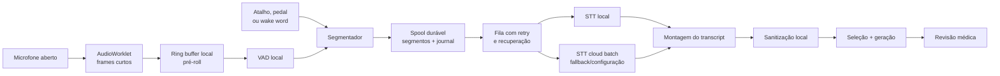

# Proposta de arquitetura de áudio resiliente e sustentável

**Data:** 19/07/2026  
**Aplicação:** Aerolince `0.1.0`  
**Objetivo:** substituir a gravação monolítica por um fluxo adequado a sessões reais de laudo de 10–15 minutos ou mais.

## 1. Decisão recomendada

O Aerolince não deve tratar “microfone aberto” como “um arquivo de áudio sendo acumulado”. São responsabilidades diferentes.

A recomendação é adotar uma arquitetura **local-first para captura e decisão**, com:

1. captura contínua em quadros curtos;
2. VAD local para detectar fala;
3. limite explícito de intenção por atalho, pedal, palavra de ativação ou modo de ditado;
4. segmentos curtos persistidos localmente antes de qualquer chamada externa;
5. transcrição por segmento, recuperável e com retry;
6. STT em nuvem inicialmente, mantendo a interface de provedor;
7. STT local com `whisper.cpp` para o modo de escuta passiva e como direção de longo prazo.

Em termos de produto, devem existir três modos distintos:

| Modo | Comportamento | Uso recomendado |
|---|---|---|
| **Comando** | O dispositivo de áudio permanece pronto, mas só há retenção durante atalho/pedal | Padrão mais seguro, barato e previsível |
| **Mãos livres** | Palavra de ativação abre uma fala; VAD local encerra por silêncio | Quando o radiologista não pode usar teclado/pedal |
| **Sessão contínua** | VAD e STT local acompanham toda a sessão; somente texto sanitizado segue para o LLM | Quando o produto realmente precisa entender toda a fala de 10–15 min |

O modo “sessão contínua enviando tudo para a nuvem” não deve ser o padrão. Ele amplia custo, superfície de privacidade, ambiguidade de intenção e dependência de rede.

## 2. Diagnóstico do fluxo atual

O caminho atual é monolítico:

1. `src/renderer/float/main.tsx` cria um `MediaRecorder`;
2. todos os `Blob`s ficam no array `chunks.current`;
3. somente em `onstop` o app monta um `Blob` completo;
4. esse `Blob` vira um `ArrayBuffer` completo;
5. o buffer inteiro atravessa o IPC;
6. `src/main/pipeline.ts` grava o buffer em `/tmp`;
7. `src/core/stt/openai.ts` envia o arquivo completo para a API de transcrição;
8. o laudo só começa a ser processado depois que todo o upload e todo o STT terminam.

Problemas objetivos:

- o consumo de memória cresce durante toda a gravação;
- podem existir várias representações do mesmo áudio ao mesmo tempo: `Blob[]`, `Blob`, `ArrayBuffer`, `Buffer` e arquivo temporário;
- falha do renderer, encerramento do app ou erro antes de `onstop` pode perder a sessão inteira;
- falha de rede após 15 minutos exige repetir um upload grande;
- não existe checkpoint, retomada, retry por trecho nem fila offline;
- não existe VAD, pré-roll, pós-roll ou separação por fala útil;
- não existe limite de duração/tamanho;
- o endpoint de arquivo usado tem limite atual de 25 MB;
- os temporários criados em `pipeline.ts` não são removidos;
- o custo exibido pelo app calcula apenas seleção/geração no LLM; o STT não entra em `custoUSD`;
- a anonimização textual acontece depois do STT: o áudio bruto já foi enviado à nuvem.

O problema principal, portanto, não é só preço. É uma combinação de **perda total**, **latência acumulada**, **processamento desnecessário**, **privacidade** e **falta de observabilidade**.

## 3. Custo: o que os preços atuais realmente mostram

Preços públicos da OpenAI em 19/07/2026:

| Modelo | Modalidade | Preço estimado |
|---|---|---:|
| `gpt-4o-transcribe` | Arquivo/batch, atual | US$ 0,006/min |
| `gpt-4o-mini-transcribe` | Arquivo/batch | US$ 0,003/min |
| `gpt-realtime-whisper` | Streaming realtime | US$ 0,017/min |

Estimativa apenas de STT, sem LLM, impostos, retries ou câmbio:

| Cenário de áudio integral | `gpt-4o-transcribe` | `mini-transcribe` | `realtime-whisper` |
|---|---:|---:|---:|
| 10 min por exame | US$ 0,060 | US$ 0,030 | US$ 0,170 |
| 15 min por exame | US$ 0,090 | US$ 0,045 | US$ 0,255 |
| 100 exames/dia, 22 dias, 10–15 min | US$ 132–198/mês | US$ 66–99/mês | US$ 374–561/mês |

Conclusões:

- o batch atual não é necessariamente proibitivo por exame, mas escala linearmente com médicos e volume;
- realtime em nuvem melhora parciais e latência, porém custa aproximadamente 2,8 vezes o batch atual;
- trocar apenas batch por realtime não é uma estratégia de redução de custo;
- se VAD + intenção reduzirem o áudio enviado para uma fração `r`, o custo de STT cai aproximadamente para `custo_integral × r`;
- o valor de `r` deve ser medido em uso real. Não deve ser estimado com os áudios curtos atuais.

O app deve medir por sessão:

- `captured_ms`;
- `speech_ms`;
- `uploaded_ms`;
- `uploaded_bytes`;
- `speech_ratio`;
- modelo e provedor;
- segmentos tentados, concluídos e repetidos;
- custo STT estimado;
- custo LLM;
- custo total;
- latência p50/p95;
- sessões recuperadas e segundos perdidos.

## 4. Comparação das alternativas de stack

### Alternativa A — VAD local + STT batch em segmentos

**Stack sugerido**

- `AudioWorklet` para captura PCM fora da thread principal;
- PCM mono a 16 kHz para VAD e Whisper local;
- Silero VAD v6 em ONNX, executado em worker/sidecar;
- spool local de segmentos;
- `gpt-4o-transcribe` ou `gpt-4o-mini-transcribe` por segmento;
- prompt contendo glossário e final do transcript anterior para continuidade.

**Vantagens**

- menor mudança sobre o pipeline atual;
- envia somente fala intencional;
- preserva o glossário que já existe;
- limita a perda a um segmento;
- permite retomar após queda de rede;
- custo variável de API cai com o tempo de fala enviado.

**Desvantagens**

- áudio bruto intencional ainda sai da máquina;
- cada segmento cria uma chamada;
- precisa reconciliar contexto e eventuais sobreposições;
- VAD detecta fala, não intenção. Sem atalho/pedal/wake word, conversa ambiente também ativa o fluxo.

**Parecer:** melhor primeira arquitetura de produção.

### Alternativa B — Transcrição realtime na nuvem

**Stack possível**

- `AudioWorklet`;
- WebSocket de transcrição;
- `gpt-realtime-whisper`;
- commits manuais por trecho;
- journal local obrigatório.

**Vantagens**

- transcript parcial na interface;
- latência percebida menor;
- feedback rápido de microfone e qualidade.

**Desvantagens**

- preço atual maior;
- conexão longa e sensível a troca de rede/suspensão;
- streaming não substitui persistência local;
- `gpt-realtime-whisper` atualmente exige que o cliente delimite/commite os trechos; o app ainda precisa de VAD/intenção local;
- o modelo realtime não aceita hoje o mesmo `prompt` de vocabulário no fluxo GA, o que pode prejudicar termos radiológicos;
- continua enviando áudio bruto.

**Parecer:** útil como opção de baixa latência, mas não como solução principal de custo ou resiliência.

### Alternativa C — STT totalmente local com `whisper.cpp`

**Stack sugerido**

- `AudioWorklet` + frames PCM;
- Silero VAD ou VAD do próprio `whisper.cpp`;
- binário `whisper.cpp` como sidecar por plataforma;
- modelos Whisper multilíngues quantizados;
- transcript local;
- sanitização local;
- somente texto sanitizado segue para seleção/geração.

**Vantagens**

- custo marginal de API de STT igual a zero;
- áudio não precisa sair da máquina;
- funciona sem internet;
- falha de rede não interrompe a captura/transcrição;
- `whisper.cpp` é C/C++ sem runtime Python, suporta CPU, Apple Silicon/Metal/Core ML, NVIDIA e Windows;
- melhor fundamento para uma sessão realmente passiva.

**Desvantagens**

- download e armazenamento de modelo;
- consumo local de CPU/GPU/RAM;
- desempenho muda conforme hardware;
- exige empacotamento de binários por arquitetura;
- modelos menores podem errar termos clínicos; modelos maiores aumentam latência;
- atualização e verificação de integridade do modelo passam a ser responsabilidade do produto.

**Parecer:** direção recomendada para o modo contínuo e para privacidade; deve entrar depois de benchmark real em hardware-alvo.

### Alternativa D — `faster-whisper`

`faster-whisper` oferece quantização, VAD Silero integrado e bom desempenho em CPU/GPU. Entretanto, seu uso típico requer Python 3.9+, CTranslate2 e, para NVIDIA, dependências CUDA/cuDNN específicas.

**Parecer:** excelente para um serviço gerenciado ou estações padronizadas. Para um Electron distribuído em Macs e PCs heterogêneos, `whisper.cpp` tende a produzir um pacote operacionalmente mais simples.

### Alternativa E — Híbrido local + nuvem sob confiança

Fluxo:

1. STT local produz transcript e indicadores de confiança;
2. glossário e regras detectam termos críticos ausentes/incertos;
3. somente o segmento incerto é reenviado ao STT de maior qualidade;
4. a interface destaca divergências para confirmação.

**Parecer:** melhor objetivo de médio prazo. Reduz custo e exposição sem transformar uma saída local incerta em verdade silenciosa.

## 5. Arquitetura-alvo



### 5.1 Captura

- manter o `MediaStream` aberto para eliminar atraso e repetição de permissões;
- substituir a acumulação de `Blob[]` por `AudioWorklet`;
- produzir quadros PCM curtos;
- enviar lotes pequenos ao processo principal/worker, evitando um IPC por frame;
- manter ring buffer de 300–500 ms para não cortar a primeira sílaba;
- nunca manter 15 minutos completos na memória do renderer.

### 5.2 Segmentação

Parâmetros iniciais para teste, não valores finais:

- início: VAD positivo em janelas consecutivas;
- pré-roll: 300–500 ms;
- fim: 700–1.200 ms de silêncio;
- pós-roll: 200–400 ms;
- segmento alvo: uma frase/ideia;
- máximo: 20–30 s;
- fala contínua maior: cortar no melhor silêncio próximo ao limite;
- overlap de 200–500 ms quando o corte for forçado;
- deduplicação textual na junção;
- prompt do segmento seguinte com contexto final do anterior quando o provedor suportar.

Os parâmetros devem ser calibrados com microfones reais, ruído de sala, sotaques e termos do domínio.

### 5.3 Persistência e recuperação

Cada segmento deve receber:

```ts
interface AudioSegment {
  sessionId: string;
  segmentId: string;
  sequence: number;
  startedAt: string;
  durationMs: number;
  sha256: string;
  state: 'writing' | 'pending' | 'transcribing' | 'done' | 'failed';
  attempts: number;
  transcript?: string;
}
```

Regras:

- persistir antes de enviar;
- finalizar arquivos por rename atômico;
- manter journal append-only ou banco em WAL;
- associar todo resultado ao `segmentId`;
- retries com backoff e jitter;
- ao iniciar o app, reabrir segmentos `pending`/`transcribing`;
- apagar áudio somente após transcript final e checkpoint;
- retenção padrão de áudio igual a zero após commit;
- criptografar spool temporário com chave protegida pelo cofre do sistema operacional;
- quota de disco e expiração obrigatórias.

Com isso, uma falha não perde “o laudo”; no pior caso perde apenas os poucos quadros ainda não persistidos.

### 5.4 Intenção é diferente de voz

VAD responde “há uma voz?”. Ele não responde:

- o médico está ditando para o Aerolince?
- está conversando com alguém?
- está lendo um nome de paciente?
- o achado pertence ao exame atual?

Por isso, o produto precisa de uma fronteira de intenção:

1. **preferida:** pedal ou push-to-talk;
2. **hands-free:** palavra de ativação local;
3. **modo contínuo:** estado explícito na interface e STT local.

Usar apenas VAD para transformar toda fala ambiente em laudo é arriscado e imprevisível.

## 6. Mudanças propostas no core

O contrato atual `STTProvider.transcribe(audioPath)` pressupõe um arquivo pronto. Ele deve evoluir para separar captura, segmentação, persistência e transcrição:

```ts
interface TranscriptionProvider {
  readonly id: string;
  transcribe(segment: PersistedAudioSegment, context: TranscriptContext): Promise<TranscriptSegment>;
}

interface SegmentStore {
  append(batch: AudioFrameBatch): Promise<void>;
  finalize(reason: 'silence' | 'manual' | 'limit'): Promise<PersistedAudioSegment>;
  markTranscribed(segmentId: string, transcript: TranscriptSegment): Promise<void>;
  recover(): AsyncIterable<PersistedAudioSegment>;
}

interface AudioSessionController {
  start(mode: 'command' | 'hands-free' | 'continuous'): Promise<void>;
  activateIntent(): void;
  deactivateIntent(): void;
  stop(): Promise<void>;
}
```

Estrutura sugerida:

```text
src/
  core/
    audio/
      types.ts
      segmenter.ts
      transcript-assembler.ts
    stt/
      provider.ts
      openai-batch.ts
      whisper-local.ts
      confidence.ts
  main/
    audio/
      session-controller.ts
      segment-store.ts
      recovery.ts
      transcription-queue.ts
  renderer/
    audio/
      capture-worklet.ts
      capture-client.ts
```

`processarAudio(Buffer)` deve deixar de ser a fronteira principal. A geração recebe um transcript consolidado e sanitizado; o subsistema de áudio administra a sessão independentemente.

## 7. Experiência de uso necessária

A bolha atual tem estados insuficientes. A interface deve distinguir:

- **microfone pronto/local:** dispositivo aberto, nada enviado;
- **ouvindo comando:** intenção ativa;
- **fala detectada:** segmento sendo gravado;
- **transcrevendo trecho N:** processamento em andamento;
- **offline — salvo localmente:** fila aguardando rede;
- **recuperado:** sessão retomada após falha;
- **atenção:** trecho de baixa confiança requer revisão.

Também deve oferecer:

- medidor simples de entrada antes do primeiro uso;
- seleção persistente de microfone;
- teste de ruído;
- aviso explícito quando áudio estiver sendo enviado;
- cancelar somente o segmento atual, não toda a sessão;
- encerrar sessão sem perder segmentos já confirmados;
- transcript incremental revisável;
- atalho/pedal configurável;
- indicador permanente e inequívoco em modo contínuo.

## 8. Plano de migração

### Fase 0 — contenção imediata

Esforço pequeno; não resolve o core, mas reduz dano:

- `MediaRecorder.start(timeslice)` para produzir dados periodicamente;
- persistir os chunks à medida que chegam;
- não assumir que cada chunk WebM é transcritível isoladamente; usar apenas para recuperação até remux/teste;
- limitar duração e tamanho;
- cancelar com limpeza garantida;
- remover temporários em `finally`;
- tratar `MediaRecorder.onerror`, perda do dispositivo e suspensão;
- incluir custo STT na telemetria;
- alertar o usuário antes de descartar áudio não processado.

### Fase 1 — arquitetura segmentada

Prioridade máxima:

- `AudioWorklet`;
- PCM em frames/lotes;
- Silero VAD local;
- intenção por atalho/pedal;
- spool durável;
- fila com recuperação;
- `gpt-4o-transcribe` por segmento;
- transcript consolidado;
- métricas completas.

### Fase 2 — custo e UX

- A/B de `gpt-4o-mini-transcribe` contra o modelo atual;
- modo hands-free com wake word local;
- transcript parcial e correção;
- fila offline visível;
- painel interno de custo por médico/exame;
- flags para trocar provedor sem alterar o pipeline.

### Fase 3 — local-first

- sidecar `whisper.cpp`;
- benchmark de modelos multilíngues quantizados em hardware-alvo;
- STT local padrão no modo contínuo;
- fallback cloud apenas para baixa confiança;
- download assinado e versionado de modelos;
- limite de CPU/RAM e diagnóstico de capacidade na instalação.

## 9. Validação obrigatória

Os áudios fake curtos não validam essa arquitetura. Criar um corpus consentido e anonimizado com:

- sessões reais de 15, 30 e 60 minutos;
- pausas longas;
- fala contínua;
- sotaques;
- ruído de sala e telefone;
- termos radiológicos;
- nomes parecidos;
- medidas, lateralidade e negações;
- troca/perda de microfone;
- queda de rede;
- suspensão do notebook;
- encerramento forçado do renderer e do processo principal.

Métricas:

- perda máxima de áudio após crash;
- taxa de recuperação;
- WER geral;
- erro em entidades clínicas críticas;
- erro em medidas, lateralidade e negação;
- falso início/falso fim do VAD;
- fala ambiente enviada indevidamente;
- `speech_ratio`;
- custo por exame;
- tempo até primeiro parcial;
- tempo do fim da fala ao transcript final;
- CPU/RAM/energia por classe de máquina.

Critérios mínimos:

- nenhum silêncio é enviado no modo comando;
- nenhum segmento já persistido se perde após crash;
- retomada automática após retorno da rede;
- memória do renderer permanece aproximadamente estável em teste de 60 min;
- nenhum arquivo temporário órfão após sucesso, erro ou cancelamento;
- falha de um segmento não invalida os anteriores;
- áudio bruto é apagado após commit conforme política;
- baixa confiança nunca vira texto clínico silenciosamente.

## 10. Recomendação final ao time

1. Não implementar “um WebSocket realtime” como correção isolada.
2. Primeiro construir captura segmentada, VAD local, intenção explícita e spool recuperável.
3. Manter `gpt-4o-transcribe` no primeiro corte para reduzir risco de migração.
4. Testar `gpt-4o-mini-transcribe` em shadow mode; promover somente se a taxa de erro clínico for aceitável.
5. Desenvolver `whisper.cpp` como provedor local para o modo contínuo.
6. Fazer o modo comando/pedal ser o padrão e o modo contínuo ser consciente e visível.
7. Medir custo de STT no próprio produto; hoje ele está fora do custo exibido.
8. Não enviar fala ambiente bruta à nuvem como comportamento padrão.

Essa sequência preserva o que já funciona no Aerolince e corrige a fragilidade estrutural sem exigir uma troca simultânea de captura, STT, LLM e interface.

## Referências técnicas

- [OpenAI — preços da API](https://developers.openai.com/api/docs/pricing)
- [OpenAI — speech to text, limites e segmentação](https://developers.openai.com/api/docs/guides/speech-to-text)
- [OpenAI — realtime transcription](https://developers.openai.com/api/docs/guides/realtime-transcription)
- [OpenAI — voice activity detection](https://developers.openai.com/api/docs/guides/realtime-vad)
- [MDN — AudioWorklet](https://developer.mozilla.org/en-US/docs/Web/API/AudioWorklet)
- [MDN — MediaRecorder e `timeslice`](https://developer.mozilla.org/en-US/docs/Web/API/MediaRecorder)
- [Silero VAD](https://github.com/snakers4/silero-vad)
- [`whisper.cpp`](https://github.com/ggml-org/whisper.cpp)
- [`faster-whisper`](https://github.com/SYSTRAN/faster-whisper)
